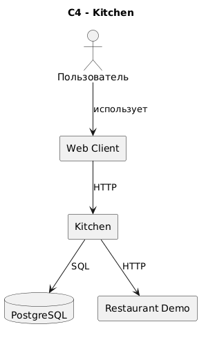

# Avito.Kitchen MVP

MVP API-сервиса для поиска ресторанов, просмотра меню и оформления заказов.

## Запуск

Переименовать `.env.example` в `.env`.

Запустить проект можно одним из двух способов:

```bash
docker compose up -d --build
```

или через Makefile:

```bash
make run-all
```

Оба варианта запускают основной сервис, PostgreSQL, миграции, демонстрационный сервис ресторана и Swagger UI.

### API-документация

После запуска интерактивная документация API доступна в Swagger UI:

```text
http://localhost:8080
```

Основной API:

```text
http://localhost:5050
```

Swagger UI использует OpenAPI-спецификацию из `openapi/openapi.yaml` и позволяет выполнять запросы к локальному API.

## Соответствие требованиям

* Один репозиторий: основной сервис `kitchen` и `restaurant-demo`.
* PostgreSQL и миграции: `migrations/`.
* OpenAPI: `openapi/openapi.yaml`.
* CJM пользователя: `docs/cjm-user.puml`.
* CJM ресторана: `docs/cjm-restaurant.puml`.
* C4 Level 2: `docs/c4.puml`.
* Docker Compose: `docker-compose.yml`.
* Линтер и статический анализ: конфигурация находится в репозитории.

Авторизация, аутентификация пользователей и клиентское web-приложение в рамках MVP не реализуются.

## Основные сценарии

### Пользователь

```text
Поиск ресторанов
       ↓
Выбор ресторана
       ↓
Просмотр меню
       ↓
Выбор доступных блюд
       ↓
Создание заказа
       ↓
Получение статуса заказа
```

### Ресторан

```text
Получение заказа
       ↓
Проверка и обработка
       ↓
Принятие или отклонение заказа
```

Сервис поддерживает:

* поиск ресторанов рядом с пользователем;
* сортировку ресторанов по расстоянию;
* определение текущего статуса ресторана;
* определение доступности доставки;
* получение меню;
* проверку доступности блюд;
* создание заказа;
* расчёт стоимости заказа на стороне сервера;
* передачу заказа во внешний сервис ресторана.

CJM обоих сценариев представлены в виде code-generated диаграмм PlantUML.

## API

### Поиск ресторанов

```http
GET /api/v1/restaurants?latitude=55.7558&longitude=37.6173
```

Рестораны возвращаются от ближайшего к самому дальнему.

Пример ответа:

```json
[
  {
    "id": "8f3a1c2e-7b4d-4f91-9c62-123456789abc",
    "name": "Пицца Хаус",
    "address": "ул. Ленина, 10",
    "distance_m": 850,
    "is_open": true,
    "delivery_available": true
  }
]
```

Поддерживается пагинация с помощью параметров `page` и `page_size`.

### Получение меню

```http
GET /api/v1/restaurants/{restaurant_id}/menu
```

Возвращает меню ресторана с указанием доступности каждой позиции.

### Создание заказа

```http
POST /api/v1/orders
```

Клиент передаёт только ресторан, позиции меню и количество:

```json
{
  "restaurant_id": "RESTAURANT_UUID",
  "items": [
    {
      "menu_item_id": "MENU_ITEM_UUID",
      "quantity": 2
    }
  ]
}
```

Цена клиентом не передаётся. Сервис получает актуальные данные меню, проверяет доступность позиций и самостоятельно рассчитывает стоимость заказа.

## Архитектура

В проекте используются два сервиса:

* `kitchen` — основной API-сервис;
* `restaurant-demo` — демонстрационный внешний сервис ресторана.

### C4 Level 2



### Основной поток

Внутри `kitchen` используется разделение на слои:

```text
HTTP Handler
      ↓
   Service
      ↓
 Repository
      ↓
 PostgreSQL
```

Интеграция с рестораном:

```text
Service
   ↓
Restaurant Client
   ↓ HTTP
Restaurant Demo
```

Основные компоненты:

* **HTTP Handler** — принимает HTTP-запросы, выполняет валидацию и формирует HTTP-ответы.
* **Service** — содержит бизнес-логику, проверки, расчёт стоимости и управление транзакциями.
* **Repository** — отвечает за SQL-запросы и работу с PostgreSQL.
* **Restaurant Client** — скрывает детали HTTP-интеграции с внешним сервисом ресторана.

## Создание заказа

Создание заказа выполняется с использованием транзакции PostgreSQL.

Перед сохранением заказа сервис:

1. валидирует входные данные;
2. получает актуальные позиции меню;
3. проверяет существование и доступность блюд;
4. рассчитывает стоимость заказа;
5. создаёт заказ и его позиции в рамках транзакции;
6. выполняет `commit`.

После успешного `commit` заказ передаётся во внешний сервис ресторана.

В MVP используются следующие статусы:

* `pending` — заказ создан и ещё не обработан внешним сервисом;
* `accepted` — ресторан принял заказ;
* `rejected` — ресторан отклонил заказ или произошла ошибка взаимодействия.

## Snapshot данных заказа

В `order_items` сохраняются название, цена и итоговая стоимость позиции на момент оформления заказа.

Это позволяет сохранить историческое состояние заказа независимо от последующих изменений меню.

Например, если на момент оформления блюда цена составляла 450 ₽, именно эта цена сохраняется в заказе. Последующее изменение цены в меню не изменит уже созданный заказ.

Таким образом:

* `menu_items` хранит текущее состояние меню;
* `order_items` хранит состояние позиции на момент создания заказа.

## База данных

Для хранения данных используется PostgreSQL.

Основные таблицы:

```text
restaurants
    │
    ├────< menu_items
    │
    └────< orders
               │
               └────< order_items
```

### `restaurants`

Хранит информацию о заведении:

* идентификатор;
* название;
* адрес;
* координаты;
* радиус доставки;
* время открытия и закрытия.

### `menu_items`

Хранит текущее состояние меню:

* идентификатор;
* ресторан;
* название;
* описание;
* цена;
* доступность.

Цена хранится в `BIGINT` в копейках.

Связь с рестораном осуществляется через `restaurant_id`.

### `orders`

Хранит:

* идентификатор заказа;
* ресторан;
* статус;
* итоговую стоимость;
* время создания.

Связь с рестораном осуществляется через `restaurant_id`.

### `order_items`

Хранит позиции заказа:

* идентификатор;
* заказ;
* исходную позицию меню;
* название;
* количество;
* цену одной позиции;
* итоговую стоимость позиции.

`name`, `unit_price` и `total_price` сохраняются как snapshot на момент создания заказа.

## Геопоиск

Расстояние между пользователем и рестораном рассчитывается непосредственно в PostgreSQL по формуле Haversine.

Результат используется для сортировки ресторанов:

```sql
ORDER BY distance_m
```

После сортировки применяются `LIMIT` и `OFFSET` для пагинации.

PostGIS в проекте не используется.

## Интеграция с ресторанами

`restaurant-demo` представляет собой упрощённый внешний сервис ресторана.

Он принимает заказ через HTTP API:

```http
POST /api/v1/orders
```

и возвращает результат его обработки.

Сервис намеренно не содержит собственной БД и сложной бизнес-логики. Его задача в рамках MVP — продемонстрировать взаимодействие основного приложения с внешним сервисом ресторана.

Основное приложение взаимодействует с рестораном через единый HTTP-контракт, а адрес сервиса определяется конфигурацией.

## Надёжность доставки заказов

В MVP после сохранения заказа в БД он синхронно передаётся во внешний сервис ресторана.

Если ресторан недоступен или возвращает ошибку, заказ переводится в `rejected`.

Для production-версии отправку можно вынести в отдельный worker и добавить:

* повторные попытки;
* exponential backoff;
* jitter;
* ограничение количества попыток;
* идемпотентность;
* reconciliation для недоставленных заказов.

Эти механизмы оставлены за пределами MVP.

## Миграции

Миграции находятся в `migrations/`.

Для управления миграциями используется `golang-migrate`.

Основные команды:

```bash
make migrate-up
make migrate-down
make migrate-create seq=...
```

Миграции создают схему базы данных и тестовые данные для ресторанов и меню.

## CJM

CJM пользователя:

```text
docs/cjm-user.puml
```

CJM ресторана:

```text
docs/cjm-restaurant.puml
```

Диаграммы выполнены в формате PlantUML и описывают основные сценарии взаимодействия участников с системой.

## OpenAPI

OpenAPI-спецификация находится в:

```text
openapi/openapi.yaml
```

Она содержит описание всех публичных endpoint'ов основного API:

* `GET /api/v1/restaurants`;
* `GET /api/v1/restaurants/{restaurant_id}/menu`;
* `POST /api/v1/orders`.

Swagger UI использует эту спецификацию для отображения интерактивной документации.

## Ограничения и упрощения MVP

В рамках MVP намеренно не реализованы:

* авторизация и аутентификация пользователей;
* клиентское web-приложение;
* оплата заказа;
* полноценная система управления заведениями;
* асинхронная обработка заказов;
* брокер сообщений;
* production-масштабирование.

Это позволяет сосредоточиться на основных пользовательских сценариях и взаимодействии `kitchen` с заведениями.

## Структура проекта

```text
.
├── cmd/
│   ├── kitchen/
│   │   ├── main.go
│   │   └── Dockerfile
│   └── restaurant-demo/
│       ├── main.go
│       └── Dockerfile
├── migrations/
├── openapi/
├── docs/
│   ├── c4.puml
│   ├── c4.png
│   ├── cjm-user.puml
│   └── cjm-restaurant.puml
├── docker-compose.yml
├── Makefile
└── README.md
```
